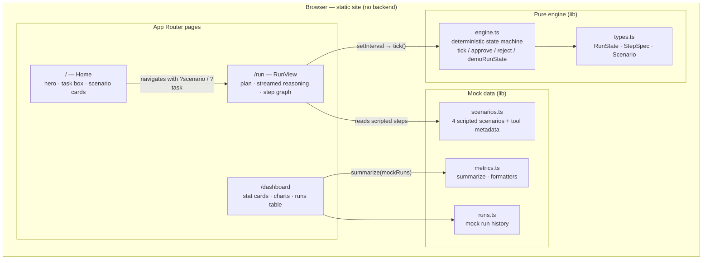
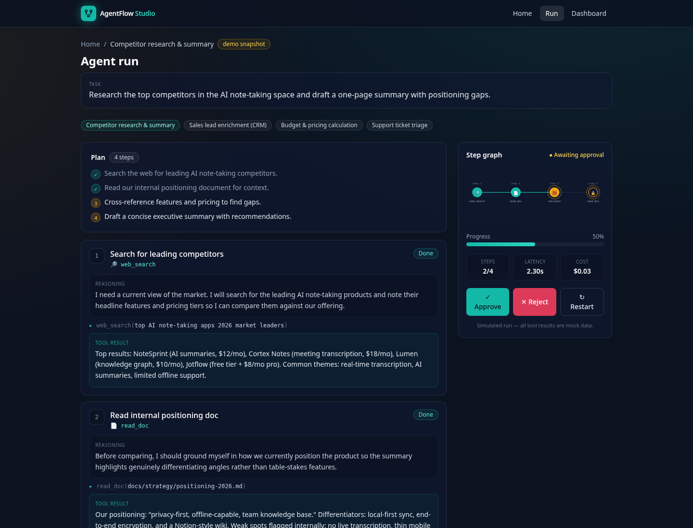
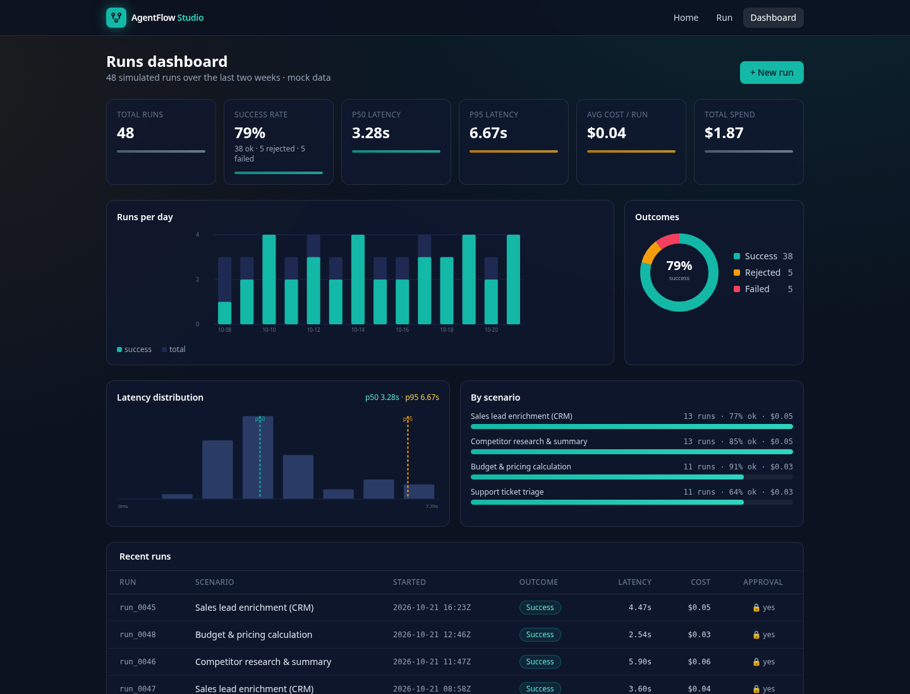

# AgentFlow Studio

> A polished, **frontend-only** simulation of an AI agent orchestrating tool calls — with a plan view, streamed reasoning, human-in-the-loop approval, a live step graph, and a metrics dashboard.

[](LICENSE)
&nbsp;Next.js 14 · React 18 · TypeScript · Tailwind CSS · Vitest

AgentFlow Studio shows what an autonomous agent runtime *feels* like: it drafts a
plan, streams token-by-token reasoning for each step, "calls tools," draws a live
step graph, and pauses for a human before it does anything sensitive — then
produces a final deliverable and logs the run to a metrics dashboard.

> [!NOTE]
> **This is a mock. There is no backend and no LLM.** Every "reasoning" stream,
> "tool result," metric, and dashboard row is hand-authored, deterministic mock
> data rendered entirely in the browser. No network calls are made and no API
> keys are required. The goal is a faithful *UX* of an agent runtime — not a real
> one. It ships as a fully static site.

---

## Architecture



The engine is a **pure, deterministic state machine**. The UI drives it by calling
`tick()` on an interval; the tests drive the exact same function synchronously in a
loop. Nothing about a run depends on wall-clock time, randomness, or the network,
so every render — and every screenshot — is reproducible.

A run moves through:

```
planning → running → (awaiting-approval → running)* → done | rejected
```

and within `running`, each step moves through:

```
pending → streaming → (awaiting-approval →) running-tool → done
```

---

## Features

- **Plan view** — the agent emits a high-level plan, then checks off each bullet as the matching step completes.
- **Streamed reasoning** — per-step reasoning is revealed character-by-character with a blinking cursor, mimicking a model "thinking."
- **Mock tool calls** — four tools (`web_search`, `read_doc`, `calculator`, `crm_lookup`) show their invocation and return canned results.
- **Human-in-the-loop approval** — the sensitive step pauses the run behind an approval gate; **Approve** resumes it, **Reject** halts the run and skips the remaining steps.
- **Live step graph** — a timeline/graph on the right tracks status, progress, and running estimates for latency and cost.
- **Metrics dashboard** — stat cards, volume/outcome/latency charts, a scenario breakdown, and a recent-runs table computed from mock history.
- **Type-your-own-task box** — free text is keyword-routed to the closest scripted scenario.
- **Demo snapshot** — `?demo=1` renders a frozen mid-run state (several steps done, one streaming, approval gate open) with no interaction — ideal for screenshots.
- **Static export** — `output: 'export'`, so it deploys to any static host with zero server runtime.

---

## Scenarios

Four end-to-end runs, each ending in a human-in-the-loop approval gate:

| Scenario | Prompt | Tools | Sensitive step |
| --- | --- | --- | --- |
| **Competitor research & summary** | Research top AI note-taking competitors and draft a one-page summary with positioning gaps. | `web_search`, `read_doc`, `calculator` | Publish summary to a shared, team-visible workspace |
| **Sales lead enrichment (CRM)** | Enrich inbound lead "Acme Robotics" and decide whether sales should prioritize it. | `crm_lookup`, `web_search`, `calculator` | Write score & assign a sales owner in the CRM |
| **Budget & pricing calculation** | Quote a 150-seat Enterprise deal with 2 add-ons and a 15% multi-year discount. | `read_doc`, `calculator` | Issue a binding quote to a prospect and finance |
| **Support ticket triage** | Triage ticket #4821 ("app crashes on export") and route it with a priority. | `read_doc`, `crm_lookup`, `calculator` | Page an on-call engineer (potential after-hours alert) |

---

## Quickstart

Requires Node.js 18.18+.

```bash
npm install        # install dependencies
npm run dev        # start the dev server at http://localhost:3000
```

Then open:

- `http://localhost:3000/` — home: task box + scenario cards
- `http://localhost:3000/run` — a live, auto-playing run (default scenario)
- `http://localhost:3000/run?scenario=sales-lead-enrichment` — pick a scenario
- `http://localhost:3000/run?demo=1` — frozen mid-run demo snapshot (no interaction needed)
- `http://localhost:3000/dashboard` — the metrics dashboard

Other scripts:

```bash
npm run build      # static production build (exports to ./out)
npm start          # serve the production build
npm run lint       # next lint
```

---

## Tests

The engine and metrics are pure functions with full unit coverage (Vitest):

```bash
npm test           # run the suite once
npm run test:watch # watch mode
```

Coverage includes the run lifecycle (`initRun` → `tick` → `approve`/`reject` →
`done`/`rejected`), that `tick` never mutates its input, that every scenario runs
to completion and halts correctly on rejection, the `?demo=1` snapshot shape, and
the dashboard metric aggregations (percentiles, success rate, cost).

---

## Screenshots

### Run view



### Metrics dashboard



> Tip: the run screenshot above is captured from `/run?demo=1`, which renders a
> stable mid-run state without any clicking.

---

## Deploy

The app is a static export (`output: 'export'` in `next.config.mjs`, with
`trailingSlash: true` and unoptimized images), so `npm run build` emits a fully
static site to `./out` that any static host can serve — no Node server at runtime.

### Vercel

Import the repository; the defaults work out of the box.

- **Framework preset:** Next.js
- **Build command:** `npm run build`
- **Output directory:** `out`

### Netlify

- **Build command:** `npm run build`
- **Publish directory:** `out`

### Any static host (GitHub Pages, S3, Cloudflare Pages, nginx…)

```bash
npm run build      # generates ./out
# then upload the contents of ./out/ to your host
```

Because routes use `trailingSlash: true`, each page is emitted as its own
`index.html` directory (e.g. `out/run/index.html`), which serves cleanly from
plain static file servers.

---

## Tech stack

- **Next.js 14** (App Router, static export)
- **React 18** + **TypeScript** (strict)
- **Tailwind CSS 3** for styling
- **Vitest** for unit tests

No runtime dependencies beyond `next`, `react`, and `react-dom`.

---

## License

[MIT](LICENSE) © Rutuj Tailor
